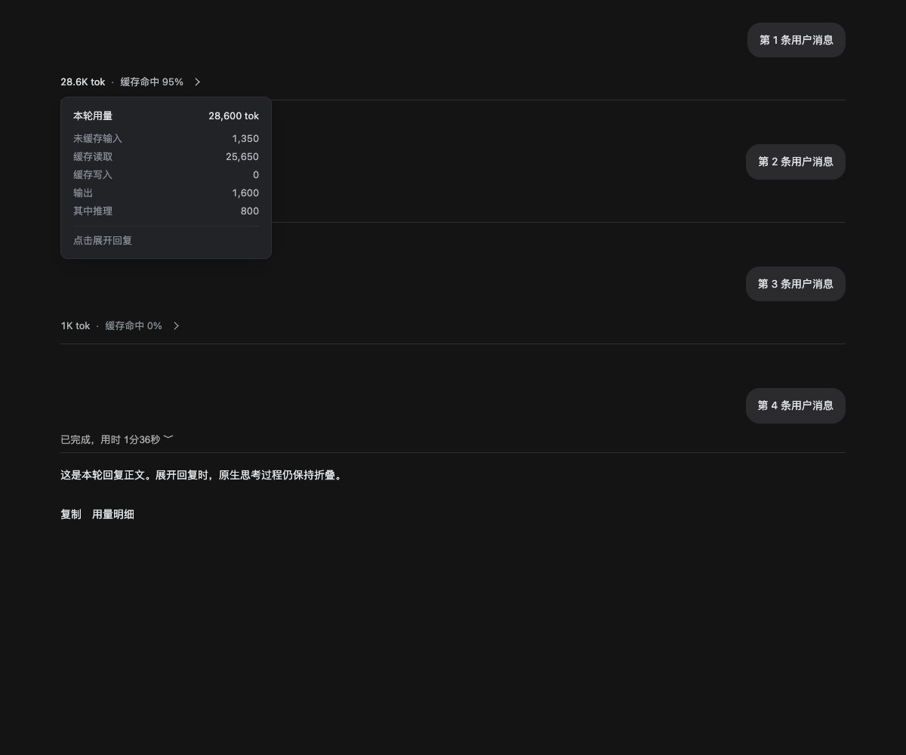
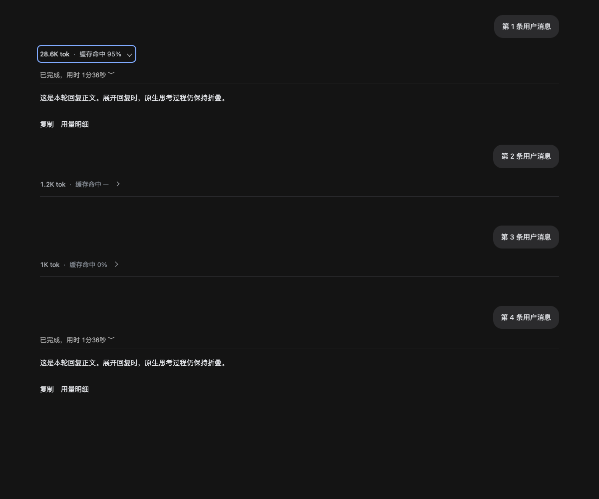

# dsh-fold-turns

为 DeepSeek Harness（DSH Desktop）的历史回复提供自动折叠、每轮 Token 用量和缓存命中率显示。

新一轮开始后，上一轮保留用户消息，将回复、过程和操作栏收起。点击用量行可以重新展开；最新一轮保持可见。

```text
28.6K tok · 缓存命中 95%  ›
────────────────────────────────
```

## 功能

- **独立折叠每轮回复**：已手动展开的历史轮次保持展开，最新轮次不折叠。
- **每轮用量**：读取 DSH 原生的完成轮次统计，不使用底部会话累计值。
- **悬停明细**：查看精确总量、未缓存输入、缓存读取、缓存写入、输出和可用的推理 Token。
- **两层独立入口**：外层控制整条回复，原生“已完成，用时……”继续控制过程内容。展开回复时，过程默认保持折叠。
- **简洁样式**：用量行与分隔线左对齐，右侧细线箭头随展开状态旋转；展开后沿用原生过程行的分隔线。
- **键盘操作**：Tab 聚焦、Enter / Space 切换，Escape 关闭明细；遵循系统减少动态效果设置。

## 预览

以下是使用合成会话生成的浏览器集成测试截图，数字为测试数据，并非原生 DSH 窗口实测截图。

| 折叠及悬停明细 | 展开回复，保留原生过程入口 |
| --- | --- |
|  |  |

## 安装

需要已安装 DeepSeek Harness，其 `dsh` 命令可用。

### 从安装包安装

下载 [Releases](https://github.com/flangnocchi/dsh-fold-turns/releases) 中的 `.tgz`，使用实际下载路径执行：

```sh
dsh plugin --profile desktop add /path/to/dsh-fold-turns-0.3.0.tgz
```

打开该 profile 的 `package.json`，确认 `dsh.profile.bundles` 数组包含 `dsh-fold-turns`。默认位置是 `~/.dsh/profiles/desktop/package.json`；若设置了 `DSH_HOME`，以该目录为准。首次安装时，将名称追加到现有数组，保留其他 bundle。

完全退出并重新打开 DeepSeek Harness 加载插件。

### 从源码打包

```sh
git clone https://github.com/flangnocchi/dsh-fold-turns.git
cd dsh-fold-turns
mkdir -p dist
pnpm pack --pack-destination dist
dsh plugin --profile desktop add ./dist/dsh-fold-turns-0.3.0.tgz
```

再按上面的步骤检查 bundle 列表并重启。插件是手写客户端模块，不需要编译。

## 数据口径

**总 Token** 是 DSH 原生记录的本轮各次模型调用总用量，包括输入和输出；输入可能包含历史上下文。

```text
本轮全部输入 Token = 本轮总 Token - 本轮输出 Token
缓存命中率 = 缓存读取 Token / 本轮全部输入 Token
```

推理 Token 是输出 Token 的组成部分，不再额外加到总量中。缓存缺失或没有有效输入时显示 `—`；真实零命中显示 `0%`。极小的非零命中显示 `<0.1%`，接近但未达到完整命中时显示 `>99.9%`。

如果 DSH 或模型服务没有提供完整的本轮统计，用量显示为 `—`，不从正文长度估算。

## 开发与测试

建议使用 Node.js 20+ 和 pnpm。运行时的 `@deepseek-ai/cordis` 由 DSH 提供，开发安装不会自动补装该 peer dependency。

```sh
pnpm install --frozen-lockfile
pnpm exec playwright install chromium
pnpm run check
pnpm test
```

也可指定已有 Chromium 可执行文件：

```sh
PLAYWRIGHT_CHROMIUM_EXECUTABLE_PATH=/path/to/chromium pnpm test
```

测试覆盖旧轮折叠、最新轮可见、每轮数据、未知缓存与零命中、对齐间距、数据层级、悬停明细、两层折叠独立、单条分隔线、键盘操作、新轮折叠、会话切换和卸载清理。测试结果与截图输出到被 Git 忽略的 `test-results/`。

这些测试运行在隔离的浏览器测试页，不能替代原生 DSH 客户端中的兼容性验证。

## 实现与兼容性

- `index.js`：空的宿主入口，用于挂载插件。
- `lib/client.js`：客户端折叠、样式、交互与用量展示。
- `cordis.patch.yml`：bundle 的加载声明。

用量来自当前主会话的 `uiSession.adapter.current` / Chat snapshot 中的 `turn-tail.tokenUsage`；折叠识别使用 `data-chat-flow`、`data-chat-turn` 等原生 DOM 标记。

插件不修改 DSH 的应用安装文件，不读取 React 内部对象，也不增加网络请求。它依赖 DSH 的内部客户端结构；应用更新后若相关结构改变，需要同步适配。本仓库是第三方插件，与 DeepSeek 官方无隶属关系。

## 卸载

从 profile 的 `dsh.profile.bundles` 中移除 `dsh-fold-turns`，执行下面的命令，然后重启 DSH：

```sh
dsh plugin --profile desktop remove dsh-fold-turns
```
